<div align="center">


[](https://kamrandev.me)
[](https://www.linkedin.com/in/kamran-khan22)
[](mailto:kamrannizamani35@gmail.com)
[](https://github.com/kamran-nizamani)


</div>

### `> whoami --verbose`

**Full-Stack Developer** and **AI/ML enthusiast** studying Computer Science at **Sukkur IBA University**. I take ideas from a blank folder to a deployed app, and I keep adding tools, certifications and side projects along the way.

```yaml
name:        Kamran Khan
education:   BS Computer Science, Sukkur IBA University (May 2027)
location:    Pakistan
focus:       [Full-Stack Development, AI/ML, Cloud Fundamentals]
exploring:   [Next.js + Supabase, TensorFlow, AWS, Security tooling]
certified:   Google Career Certificates x5
open_to:     [Internships, Freelance Work, Open Source, Mentorship]
```

### `> stats --live`

<div align="center">

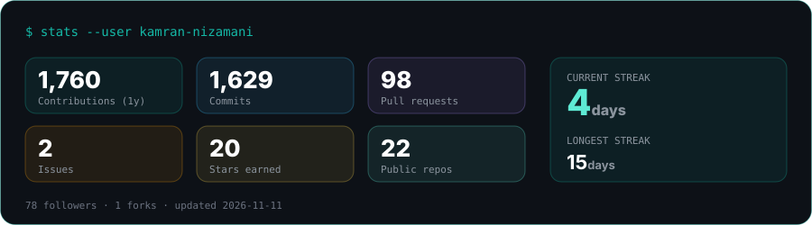

</div>

## ⚡ Stack

<div align="center">


<br><br>


</div>

## 🛰️ Featured Builds

<div align="center">
<table>
<tr>
<td></td>
<td><a href="https://github.com/kamran-nizamani/OpenReseach"></a></td>
</tr>
<tr>
<td><a href="https://github.com/kamran-nizamani/CortexWard"></a></td>
<td><a href="https://github.com/kamran-nizamani/portfolio"></a></td>
</tr>
</table>
</div>

<sub>Click a card to open the repository. Dashboard is a private repository.</sub>

<div align="center">


</div>

## 📡 Signal

<div align="center">

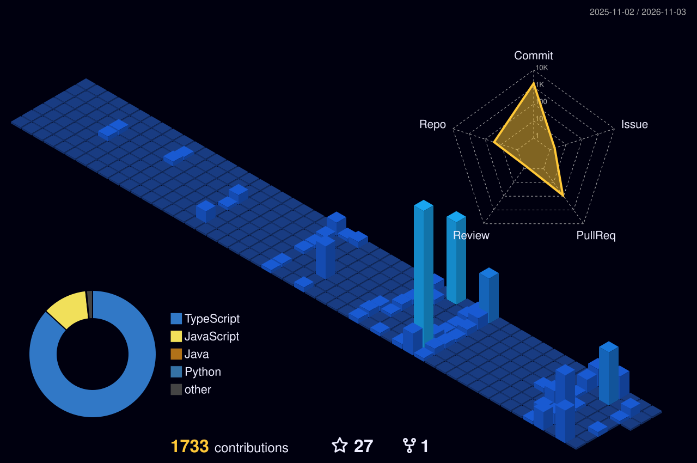


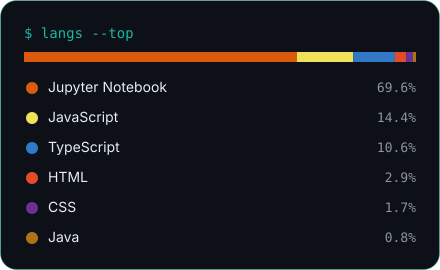

</div>

## 🎓 Certifications

<div align="center">

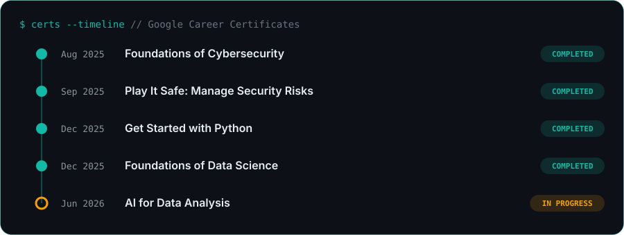

</div>

## 🧭 Currently

```diff
+ Finishing AI for Data Analysis (Google Career Certificates)
+ Going deeper on Next.js, Supabase and TensorFlow
+ Contributing to open-source projects
! Preparing for AWS Cloud Practitioner
```

## 🤝 Let's Build Something

Open to **internships**, **freelance full-stack and AI work**, **open-source collaboration** and **mentorship**. If you're building something interesting, my inbox is open.

<div align="center">

[](https://www.linkedin.com/in/kamran-khan22)
[](mailto:kamrannizamani35@gmail.com)
[](https://kamrandev.me)


⭐ If something here caught your eye, a star goes a long way.


</div>
